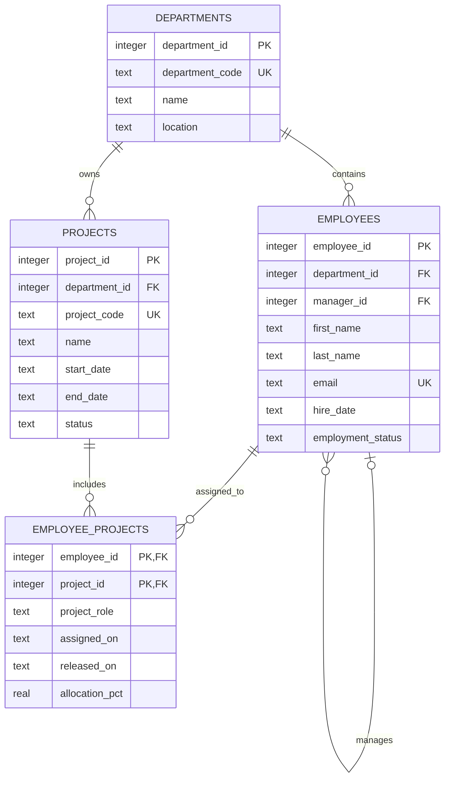

# Employee Management System Database Design

## Scope and Assumptions

This relational design supports employee records, organizational departments, projects, and employee assignments to projects. It targets SQLite for the initial release. Each employee belongs to one department; each project is owned by one department; employees and projects have a many-to-many relationship through `employee_projects`.

Employee email and department/project codes are unique business identifiers. `manager_id` is optional and references another employee. Dates are stored as ISO 8601 text (`YYYY-MM-DD`); timestamps use SQLite's `CURRENT_TIMESTAMP` text representation. Project and assignment states are constrained to documented values. The schema stores a minimal employee profile and intentionally excludes highly sensitive fields such as government identifiers and compensation.

## 1. ER Diagram

## 2. Table Definitions and Keys

| Table               | Purpose                                         | Primary key                              | Foreign keys                                                                            | Other constraints                                                          |
| ------------------- | ----------------------------------------------- | ---------------------------------------- | --------------------------------------------------------------------------------------- | -------------------------------------------------------------------------- |
| `departments`       | Organizational units employees belong to        | `department_id`                          | None                                                                                    | Unique `department_code` and `name`                                        |
| `employees`         | Employee profile and reporting relationship     | `employee_id`                            | `department_id` -> `departments.department_id`; `manager_id` -> `employees.employee_id` | Unique email; status check; manager is optional; manager cannot be self    |
| `projects`          | Projects owned by a department                  | `project_id`                             | `department_id` -> `departments.department_id`                                          | Unique project code; status check; end date cannot precede start date      |
| `employee_projects` | Employee assignment and allocation on a project | Composite: (`employee_id`, `project_id`) | `employee_id` -> `employees.employee_id`; `project_id` -> `projects.project_id`         | Allocation between 0 and 100%; release date cannot precede assignment date |

## 3. Create Table and Insert Scripts

The executable SQLite DDL and seed data are in [`database_schema.sql`](database_schema.sql). Run the script against a new or empty SQLite database with `sqlite3 insight.db ".read database_schema.sql"`. It enables foreign-key enforcement, creates all four tables, keys, checks, and indexes, then inserts five departments, twenty employees, ten projects, and example project assignments.

## 4. Relationship and Deletion Behavior

- A department with employees or projects cannot be deleted until those records are reassigned or removed (`RESTRICT`).
- Deleting an employee or project removes its assignment rows (`CASCADE`), preventing orphaned assignments.
- Deleting an employee who is still referenced as a manager is restricted; reassign reports before deletion.
- An employee can participate in a project only once at a time in this initial model. The composite key represents one current assignment per employee/project pair; assignment history can be added later if needed.

## 5. Sample Data Coverage

The seed script provides usable examples across five departments (People, Engineering, Finance, Operations, and Sales), twenty employees, ten projects, and employee-to-project assignments. Employee manager references are applied after employee records are inserted to preserve valid foreign keys throughout seeding.
