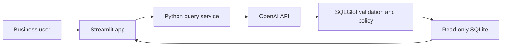

# InsightSQL

InsightSQL is a Streamlit workforce analytics assistant. Users ask questions in plain English; OpenAI proposes a SQLite query; the application validates it; then SQLite runs it and the UI presents results. Users can inspect generated SQL, review session query history, and export results as CSV.

## Overview

InsightSQL is designed to make workforce data easier to explore without requiring users to write SQL. The current implementation supports the departments, employees, projects, and employee-project assignments in the local SQLite database.

An OpenAI API key is required for natural-language query generation. The default test suite and database initialization do not call OpenAI. The application sends the user's question, a fixed schema description, and limited conversation context to OpenAI; it does not send SQLite result rows or database credentials.

## Setup

### Requirements

- Python 3.11 or newer
- An OpenAI API key for natural-language questions
- SQLite, included with Python

### Install

From the repository root, create and activate a virtual environment, then install dependencies.

```powershell
python -m venv .venv
.\.venv\Scripts\Activate.ps1
python -m pip install -r requirements.txt
```

For macOS/Linux, activate the environment with `source .venv/bin/activate` after creating it.

### Configure

The application reads configuration from process environment variables. The project-root `.env` file is ignored by Git, but the application does not parse that file automatically; export values in your shell or configure them in your deployment environment.

PowerShell example:

```powershell
$env:OPENAI_API_KEY = "your-key"
$env:OPENAI_MODEL = "gpt-4o-mini"
$env:INSIGHTSQL_DB_PATH = "data/insightsql.db"
```

Supported settings:

| Variable                           | Default               | Purpose                                                                 |
| ---------------------------------- | --------------------- | ----------------------------------------------------------------------- |
| `OPENAI_API_KEY`                   | None                  | OpenAI credential; required to submit questions                         |
| `OPENAI_MODEL`                     | `gpt-4o-mini`         | Model used to propose SQL                                               |
| `INSIGHTSQL_DB_PATH`               | `data/insightsql.db`  | SQLite file path; relative paths resolve from the project root          |
| `INSIGHTSQL_ENV`                   | `development`         | Set to `production` to require authentication by default                |
| `INSIGHTSQL_AUTH_REQUIRED`         | Environment dependent | Explicitly enable or disable Streamlit sign-in                          |
| `INSIGHTSQL_ALLOWED_EMAILS`        | Empty                 | Comma-separated email allowlist required when authentication is enabled |
| `INSIGHTSQL_MAX_ROWS`              | `500`                 | Maximum rows returned to the UI; valid range is 1-5000                  |
| `INSIGHTSQL_QUERY_TIMEOUT_SECONDS` | `5`                   | SQLite query time limit in seconds; valid range is 0.1-60               |

Do not place real credentials in tracked files, paste keys into chat, or log them. Use a deployment secret manager for hosted environments.

## Architecture



`app.py` provides the Streamlit experience. `insightsql/service.py` coordinates query generation and execution. `insightsql/llm.py` calls OpenAI; `insightsql/sql_policy.py` validates generated SQL and binds literals; and `insightsql/database.py` initializes the schema and executes read-only queries. `insightsql/config.py` loads process settings. See [SYSTEM_DESIGN.md](SYSTEM_DESIGN.md) for the full diagrams, module responsibilities, and operational constraints.

## Database Design

The SQLite schema contains:

- `departments`: department names, codes, and locations.
- `employees`: department membership, reporting relationships, job titles, and employment dates/status.
- `projects`: projects owned by departments, including dates and status.
- `employee_projects`: employee/project assignments and allocation percentages.

The schema, indexes, constraints, and synthetic seed rows are defined in [database_schema.sql](database_schema.sql). The detailed ER diagram and key definitions are in [DATABASE_DESIGN.md](DATABASE_DESIGN.md).

Initialize an empty database before first launch if you want to use demo rows:

```powershell
python -m insightsql.init_db --seed
```

To create the schema without sample rows, run `python -m insightsql.init_db`. Initialization never overwrites a non-empty database. If the app starts and the configured database does not exist, it creates an empty schema automatically; that database will not contain demo data. Database files and the `data/` directory are excluded by `.gitignore`.

## Running Application

After setup and configuration, run:

```powershell
streamlit run app.py
```

Open the local URL printed by Streamlit, usually `http://localhost:8501`. The UI includes example questions, a natural-language input, results, generated SQL, CSV download, and session-scoped query history. Without `OPENAI_API_KEY`, the UI remains available but question submission displays a configuration message.

### Production Sign-In

For a hosted deployment, configure Streamlit OIDC in `.streamlit/secrets.toml` and set `INSIGHTSQL_ENV=production`, `INSIGHTSQL_AUTH_REQUIRED=true`, and `INSIGHTSQL_ALLOWED_EMAILS` to the permitted user emails. The secrets file is ignored by Git. Configure HTTPS at the deployment boundary. Development mode defaults to authentication off and must not be exposed to an untrusted network.

The email allowlist is not role-based or department-level authorization. Do not treat it as sufficient access control for production workforce data; see [SECURITY_REVIEW.md](SECURITY_REVIEW.md).

## Running Tests

Run the offline pytest suite from the repository root:

```powershell
python -m pytest
```

Tests use temporary SQLite databases and synthetic records. They cover SQL allow/deny rules, read-only execution, row limits, service behavior, and a Streamlit smoke test. The suite does not make live OpenAI requests. See [CODE_REVIEW.md](CODE_REVIEW.md) and [SECURITY_REVIEW.md](SECURITY_REVIEW.md) for identified coverage and production-hardening gaps.

## Troubleshooting

| Symptom                                                  | Resolution                                                                                                                                                                                                                                                       |
| -------------------------------------------------------- | ---------------------------------------------------------------------------------------------------------------------------------------------------------------------------------------------------------------------------------------------------------------- |
| Question submission says AI generation is not configured | Set `OPENAI_API_KEY` in the same shell/process that launches Streamlit, then restart the app. A `.env` file is not loaded automatically.                                                                                                                         |
| Results are empty                                        | The app may have created an empty schema. Initialization does not overwrite it. Stop the app, set `INSIGHTSQL_DB_PATH` to a new filename such as `data/insightsql-demo.db`, run `python -m insightsql.init_db --seed`, then restart the app with that same path. |
| Database file cannot be opened                           | Check that `INSIGHTSQL_DB_PATH` points to a valid SQLite file and that the application account can read it. Use the initialization command for a new database.                                                                                                   |
| Query is rejected                                        | The validator only permits one `SELECT` over approved tables and columns. Rephrase the question to request an aggregate and avoid direct employee identifiers or unsupported SQLite functions.                                                                   |
| Query times out or exceeds the row limit                 | Narrow the question with filters or aggregation. The configured timeout and row cap are intentional safeguards.                                                                                                                                                  |
| Sign-in is unavailable in production                     | Verify Streamlit OIDC settings in `.streamlit/secrets.toml`, `INSIGHTSQL_AUTH_REQUIRED`, and the allowed-email list. Never disable authentication to work around an OIDC setup issue on a public deployment.                                                     |
| `python -m pytest` cannot find pytest                    | Activate the project virtual environment and run `python -m pip install -r requirements.txt`.                                                                                                                                                                    |

## Security Guidance

- Generated SQL is untrusted. SQLGlot restricts the query to one `SELECT`; SQLite additionally uses a read-only connection, query-only mode, an authorizer, a progress timeout, and a row limit. Keep these controls in place and test both validation and execution boundaries.
- The UI and query history are not a substitute for authorization. Current production sign-in uses an email allowlist; it does not enforce roles or department-level row access.
- Direct identifiers are restricted, but some employee attributes and small aggregate groups may still be re-identifiable. Do not load real workforce data until role/scope authorization, aggregate suppression, and other findings in [SECURITY_REVIEW.md](SECURITY_REVIEW.md) are addressed.
- SQLite database files are not encrypted by the application. Use encrypted storage and backups, restrict filesystem access, and keep database files out of source control and public/static directories.
- `.env` and `.streamlit/secrets.toml` are Git-ignored. Git ignore rules do not remove credentials already committed. Rotate exposed keys and scan repository history if exposure is suspected.
- Only schema metadata and the question/conversation context are sent to OpenAI; query result rows are not. Review provider retention settings and privacy obligations before sending business questions that may contain personal information.
- Logs are intended to exclude raw questions, SQL, and result rows. Query history is session-scoped and is not a durable audit trail.
- Review [SECURITY_REVIEW.md](SECURITY_REVIEW.md) before deployment. The current implementation is a preproduction MVP, not a complete enterprise authorization or workforce-privacy solution.
