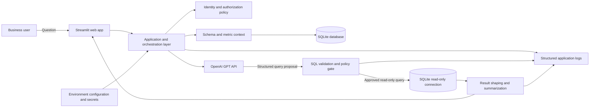
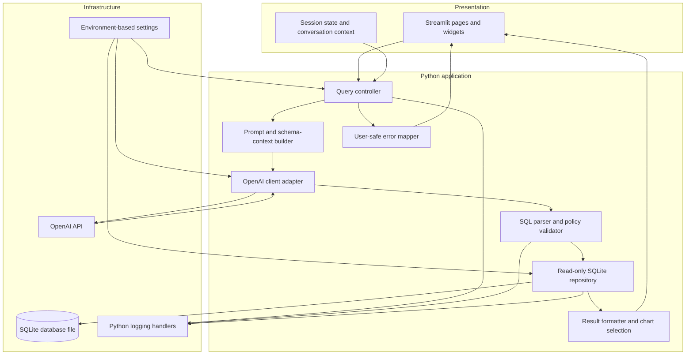
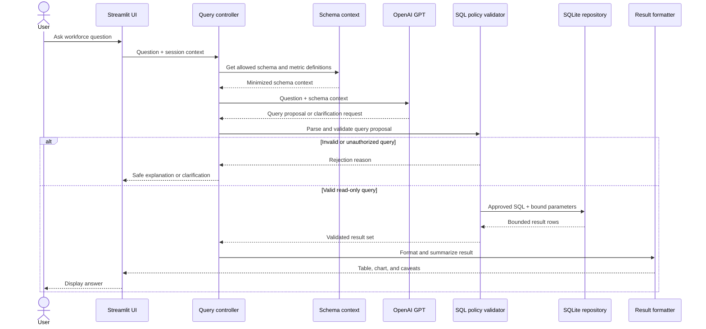

# InsightSQL System Design

## 1. Architecture Diagram



**Deployment boundary:** Streamlit, Python services, and the SQLite file run in one trusted application environment. OpenAI is an external service and receives only the minimum information needed to formulate a query. Database contents and credentials are not sent to the model by default.

## 2. Component Diagram



**Component responsibilities**

- **Streamlit presentation:** Collect questions, maintain conversation state, show clarification prompts, results, charts, and understandable errors. It does not contain SQL policy or database access logic.
- **Query controller:** Orchestrate the request lifecycle, apply user/session context, enforce timeouts, and coordinate service calls.
- **Prompt and schema-context builder:** Provide GPT only approved table/column descriptions, metric definitions, and relevant conversation context. Avoid transmitting sample or production rows.
- **OpenAI client adapter:** Encapsulate API calls, model configuration, retry limits, and response parsing. Keep provider-specific behavior outside business logic.
- **SQL parser and policy validator:** Parse proposed SQL, enforce a single read-only `SELECT`/CTE statement, allowlist tables and columns, reject unsupported functions or constructs, and apply row/time limits. Never rely on prompt instructions as a security boundary.
- **Read-only SQLite repository:** Open a read-only connection for analytics, bind values as parameters, apply a query timeout/progress handler, and return bounded result sets.
- **Result formatter:** Convert rows into a concise, typed presentation and choose appropriate tables/charts. Treat generated summaries as untrusted text.
- **Error mapper and telemetry:** Map internal failures to user-safe messages and log diagnostic context without credentials, full prompts, or sensitive row data.

## 3. Data Flow Diagram



1. The user submits a natural-language question. The UI applies input-size limits and retains only necessary conversational context.
2. The application resolves the user's allowed data scope and retrieves an allowlisted schema/metric description.
3. GPT receives the question and minimized metadata. It returns a structured proposal, clarification, or refusal; it does not receive database credentials or execute SQL.
4. The validator parses the proposal, verifies its read-only form, table/column permissions, complexity, and result limits. Invalid proposals are rejected or regenerated a bounded number of times.
5. The repository runs approved SQL through a read-only SQLite connection, with bound parameters, a progress timeout, and a maximum row count.
6. The formatter returns data and a concise explanation. The UI renders results and communicates caveats; operational logs record the outcome without sensitive content.

## 4. Folder Structure

```text
InsightSQL/
├── app.py                         # Streamlit entry point and UI
├── database_schema.sql            # SQLite schema and development seed data
├── insightsql/
│   ├── __init__.py
│   ├── config.py                  # Validated environment configuration
│   ├── database.py                # SQLite initialization and read-only execution
│   ├── errors.py                  # User-safe application exceptions
│   ├── init_db.py                 # Explicit database initialization CLI
│   ├── llm.py                     # OpenAI adapter and response parsing
│   ├── logging_config.py          # Structured logging setup
│   ├── service.py                 # Query lifecycle and orchestration
│   └── sql_policy.py              # SQL parsing, allowlists, literal binding
├── tests/
│   ├── test_app.py
│   ├── test_database.py           # Temporary SQLite database tests
│   ├── test_service.py
│   ├── test_sql_policy.py
├── .env                            # Local-only configuration; ignored by Git
├── .gitignore                     # Exclude local DBs, secrets, caches
├── pyproject.toml                 # Pytest configuration
├── README.md
└── requirements.txt               # Runtime and test dependencies
```

Keep UI code thin and import application services; do not put API calls or query execution directly in Streamlit callbacks. Store the SQLite file outside version control and outside publicly served static directories.

## 5. Security Strategy

- **SQLite setup:** [`database_schema.sql`](database_schema.sql) is the SQLite bootstrap schema and development seed. Enable `PRAGMA foreign_keys = ON` on every application connection; this setting is connection-local. Keep schema initialization separate from the read-only query connection used for analytics.
- **Least privilege:** Open analytics connections using SQLite URI `mode=ro`. Use a separate controlled migration/initialization path for schema writes. Restrict filesystem permissions on the database and backup files.
- **SQL is untrusted:** Parse model output with a maintained SQL parser. Permit only one read-only query; reject DDL, DML, pragmas, attach/detach, multiple statements, extension loading, unapproved tables/columns, and dangerous functions. Do not use regex as the only SQL validator.
- **Bounded execution:** Bind all data values as parameters, cap result rows and query complexity, and use SQLite's progress handler to interrupt long-running queries. A read-only connection is defense in depth, not a replacement for validation.
- **Data minimization:** Send schema and metric metadata rather than employee records to OpenAI. Do not ask the model to determine authorization. Filter allowed columns and rows in application code before execution, based on authenticated user scope.
- **Sensitive workforce data:** Exclude direct identifiers and sensitive attributes from the model context and default query allowlist. Apply minimum cohort thresholds for aggregate reports to reduce re-identification risk where appropriate.
- **Secret management:** Load the OpenAI API key from deployment secrets/environment configuration. Never commit keys, include them in client-visible Streamlit state, or log them. Rotate keys and use separate development and production credentials.
- **Transport and retention:** Require HTTPS at the deployment boundary. Review the OpenAI account's data handling/retention configuration and organizational privacy requirements before sending prompts.
- **Threat model:** Treat prompt injection in user text, stored data, and model responses as possible. Model-generated instructions never alter application policy or database permissions.

## 6. Logging Strategy

- Use Python's `logging` module with structured JSON output in deployed environments and readable output locally.
- Include timestamp, severity, request/correlation ID, operation, duration, outcome, and sanitized error category. Avoid logging user identity unless operationally required; use a pseudonymous identifier when possible.
- Log lifecycle events: request accepted, model call outcome/latency, SQL validation outcome, query duration/row count, timeout, and unexpected exception.
- Do not log API keys, database paths containing secrets, full prompts, generated SQL containing user data, raw result rows, or sensitive employee attributes. If SQL diagnostics are required, store a normalized/redacted form with restricted access.
- Keep audit events distinct from debug logs; protect access, define retention, and avoid writing audit records only to the database being queried.
- Configure log level and retention by environment; do not expose stack traces or internal diagnostics in the UI.

## 7. Exception Handling Strategy

- Define application exceptions for invalid question, clarification required, model/API failure, rejected SQL, database timeout, database unavailable, and unexpected internal failure.
- Catch errors at boundaries: OpenAI adapter, SQL validator/repository, orchestration layer, and Streamlit UI. Preserve the original exception as a chained cause for internal diagnostics.
- Retry only transient OpenAI/network failures, with a small bounded retry count, exponential backoff, and request timeout. Do not retry policy rejections or invalid SQL indefinitely.
- On SQLite busy/locked and timeout errors, stop execution, record a sanitized event, and return a retry-later message. Do not silently return partial or stale results.
- Show actionable, non-sensitive messages to users; include a correlation ID for support. Keep raw exception text and stack traces in access-controlled logs only.
- Fail closed: if authorization, validation, or result shaping fails, do not run or display the query output.

## 8. Testing Strategy

- **Unit tests with pytest:** Test prompt/context construction, response parsing, SQL allow/deny rules, row/complexity limits, authorization filters, error mapping, and result formatting. Mock the OpenAI adapter at unit boundaries.
- **Repository integration tests:** Use a fresh temporary SQLite database per test, apply the SQLite schema, and insert deterministic fixtures. Verify read-only enforcement, bound parameter behavior, foreign-key expectations, row caps, and timeout handling.
- **Orchestration tests:** Exercise the real request lifecycle with a stubbed GPT response and real temporary SQLite data. Cover valid questions, clarification, invalid SQL, unauthorized data, empty results, and transient provider failures.
- **Security regression tests:** Include malicious inputs and model proposals (multiple statements, writes, schema discovery, unapproved columns, prompt injection, and oversized queries). Assert that no database mutation occurs.
- **Streamlit smoke tests:** Verify the application starts, accepts a question, renders a result/error, and does not expose secrets. Keep UI tests limited to user-visible behavior.
- **Contract and environment tests:** Validate required configuration and OpenAI response shape. Any tests that call the real OpenAI API should be opt-in, separately marked, and excluded from the default offline test suite.
- **CI gates:** Run formatting/linting, type checks if configured, and `pytest` on every change. Use coverage to identify untested policy and error paths; prioritize security-critical branches over a global percentage target.
- **Test data hygiene:** Use synthetic employee data only. Never point automated tests at production databases or use production credentials.

## Operational Constraints

SQLite is suitable for a focused single-instance MVP with modest concurrent writes and a locally attached database file. The design is read-heavy, but SQLite still serializes writes and does not provide safe shared-disk multi-instance scaling. Keep the database on reliable local storage, enable backups, and monitor lock contention and file growth. If deployment requires multiple application replicas, frequent concurrent writes, or high availability, migrate to a client-server database and update the connection/repository layer before scaling out.
